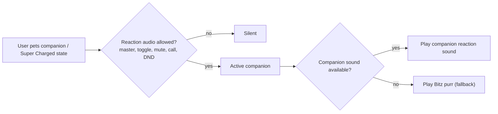

# Mission Specification: Archetype-Specific Companion Sound Design

**Mission Branch**: `feat/issue-150-archetype-sound-design`  
**Created**: 2026-11-11  
**Status**: Ready for Planning  
**Input**: GitHub issue #150: "[Feature]: Archetype-Specific Sound Design for Mascot Roster (Replacing Universal Cat Purr)" (Closes #150, refs #150)

---

## 1. Purpose

Every companion in the multi-mascot roster (#30) — Bitz, Drako, Byte, Aero, Pixel, Volt — currently reacts to petting and to the Super Charged state with the same domestic cat purr. That fits Bitz the Cyber Cat but breaks immersion for a mecha-wyvern, a K9 hound, a hover drone, a CRT robot, or a bionic bunny. This mission gives each companion its own reaction sound that follows the active companion, surfaces it in Settings, and lets users audition sounds before choosing a companion — without any change to Bitz's idle CPU, memory, or suppression behaviour.

### Companion Reaction Sound Identities

| Companion | Archetype | Reaction sound identity |
|---|---|---|
| **Bitz** | The Cyber Cat (default) | Soothing cyber-feline purr (existing `purr_loop.wav`, unchanged) |
| **Drako** | The Cyber Dragon | Low-frequency plasma hum / draconic flame-core rumble |
| **Byte** | The Cyber Hound | Tactical servo whine / metallic pant / digital chirp |
| **Aero** | The Hover Sentinel | Antigravity turbine spool / harmonic ion levitation tone |
| **Pixel** | The Retro Mech | Hydraulic stepper click / cassette drive relay whir |
| **Volt** | The Cyber Bunny | High-voltage capacitor chirp / bionic pulse |

---

## 2. User Scenarios & Testing *(mandatory)*

### User Story 1 - Companion Reacts With Its Own Voice (Priority: P1)

A user who has selected Drako pets the companion (or Bitz reaches Super Charged). Instead of a cat purr, they hear Drako's plasma rumble. Every companion has a distinct acoustic identity matching its look and lore.

**Why this priority**: Core value of issue #150 — immersion per companion.

**Independent Test**: For each companion, resolve the reaction sound and trigger a petting reaction with a test audio environment; verify the companion's own sound is the one scheduled, and that the six companions resolve to six distinct sounds.

**Acceptance Scenarios**:
1. **Given** Bitz is the active companion, **When** the user pets it, **Then** the existing soothing cat purr plays exactly as today.
2. **Given** Drako, Byte, Aero, Pixel, or Volt is active, **When** the user pets it, **Then** that companion's own reaction sound plays and the cat purr does not.
3. **Given** any companion is active and the mascot enters Super Charged, **When** periodic comfort sounds fire (45–90 s intervals), **Then** each burst uses the active companion's reaction sound.

---

### User Story 2 - Switching Companions Switches the Sound Instantly (Priority: P1)

A user switches from Bitz to Pixel in Settings or the Menu Bar. The very next reaction sound — petting, periodic Super Charged burst, or preview — is Pixel's relay whir, with no restart required.

**Why this priority**: Without live routing, the feature is broken for anyone who changes companions.

**Independent Test**: With a companion selection source and the audio service wired together, change the selected companion and verify the next reaction resolves to the new companion's sound; verify a reaction already playing is not cut off mid-sound unless a new one starts.

**Acceptance Scenarios**:
1. **Given** Bitz is active and Super Charged comfort sounds are scheduled, **When** the user switches to Volt, **Then** the next scheduled burst plays Volt's capacitor chirp.
2. **Given** a Pro companion is selected and the licence is deactivated, **When** the selection reverts to Bitz, **Then** reaction audio reverts to the cat purr.

---

### User Story 3 - Hear and Audition Companion Sounds in Settings (Priority: P2)

In Settings → Audio, the reaction-sound row names the active companion's sound (e.g. "Companion Reaction: Drako — Plasma Wyvern Rumble") and has a preview button that plays it. In Settings → Appearance → Character Roster, each companion card has a small preview button so users can audition every companion's sound — including locked Pro companions — before selecting.

**Why this priority**: Discoverability and choice; the core behaviour (US1/US2) works without it.

**Independent Test**: Render the Audio and Appearance settings with a mock audio player; verify the reaction row label tracks the active companion, and each roster card preview requests that card's companion sound (not the active one).

**Acceptance Scenarios**:
1. **Given** Byte is active, **When** the user opens Settings → Audio, **Then** the reaction row shows Byte's sound name and its preview plays Byte's sound.
2. **Given** the user is on the Free tier, **When** they press the preview button on Aero's (Pro) card, **Then** Aero's sound plays without changing the active companion and without triggering the upgrade flow.
3. **Given** the reaction-sound toggle is off, **When** the user presses any preview button, **Then** preview behaves exactly as other sound previews do today (previews follow the same rules as existing per-event test buttons).

---

### Edge Cases

- **Missing or undecodable companion asset**: The companion falls back to Bitz's purr rather than going silent; if the purr is also missing, nothing plays and no error is shown to the user.
- **Suppression**: Muted output, mic/screen capture in use (call suppression), Focus/DND, the master toggle, and the reaction toggle silence every companion's sound identically to today's purr.
- **Companion switch mid-sound**: The currently playing reaction finishes (or is stopped by the normal stop rules); the next reaction uses the new companion.
- **Existing preference**: Users who turned off "purr" keep reaction sounds off for all companions after upgrading; users who had it on keep it on.
- **Unknown companion value** (future roster additions without an asset): falls back to Bitz's purr.

---

## 3. Requirements *(mandatory)*

### Functional Requirements

| ID | Title | User Story | Priority | Status |
|----|-------|------------|----------|--------|
| FR-001 | Per-companion reaction sound | As a user, I want each companion (Bitz, Drako, Byte, Aero, Pixel, Volt) to have its own petting/comfort reaction sound so that it matches the companion's anatomy and lore. | High | Open |
| FR-002 | Live routing to active companion | As a user, I want changing my companion (Settings, Menu Bar, or licence-driven revert) to immediately route petting reactions, periodic Super Charged bursts, and reaction previews to the new companion's sound so that I never hear the wrong companion. | High | Open |
| FR-003 | Fallback to Bitz purr | As a user, I want a companion whose sound is missing or fails to load to fall back to Bitz's purr so that reactions never silently disappear. | High | Open |
| FR-004 | Companion-aware Audio settings row | As a user, I want Settings → Audio to show the active companion's reaction sound name and offer a preview button for it so that I know what I'll hear. | Medium | Open |
| FR-005 | Roster card sound preview | As a user, I want a preview button on every Character Roster card (including locked Pro companions) that plays that card's sound without selecting it so that I can audition companions before choosing. | Medium | Open |
| FR-006 | Preference continuity | As an existing user, I want my current purr on/off preference to carry over and govern all companion reaction sounds so that upgrading doesn't change my audio settings. | High | Open |
| FR-007 | Reproducible companion sound assets | As a maintainer, I want the five new companion sounds produced by a checked-in, deterministic generator so that they can be regenerated, tuned, and are free of licensing concerns; if listening review rejects them, they are replaced with curated CC0/public-domain recordings documented in the sounds licence file. | High | Open |

### Non-Functional Requirements

| ID | Title | Requirement | Category | Priority | Status |
|----|-------|-------------|----------|----------|--------|
| NFR-001 | Idle CPU budget | Desktop idle CPU stays `< 2%` in a release build with Settings closed; the audio engine remains paused whenever no sound is playing (0.0% audio idle CPU). | Performance | High | Open |
| NFR-002 | Memory budget | Total app RSS stays `< 70 MB`; each companion sound is decoded at most once and cached, with no growth across 50 companion switches. | Performance | High | Open |
| NFR-003 | Asset size | Each new companion sound file is `< 100 KB` and `≤ 3.0 s`; the existing `purr_loop.wav` (132 KB) is exempt as a pre-existing asset. | Footprint | Medium | Open |
| NFR-004 | Reaction latency | A companion reaction sound starts within `50 ms` of the petting trigger, matching existing sound latency. | Performance | Medium | Open |
| NFR-005 | Deterministic tests | Unit tests cover companion→sound mapping for all 6 companions, sound resolution on companion change, missing-asset fallback, suppression gating, and preference continuity; all use isolated `UserDefaults(suiteName:)` domains and pass via `xcrun swift test` with zero failures. | Reliability | High | Open |

### Constraints

| ID | Title | Constraint | Category | Priority | Status |
|----|-------|------------|----------|----------|--------|
| C-001 | Suppression parity | Companion sounds must obey exactly the same master, toggle, system-mute, call/screen-capture, and Focus/DND gates as the current purr. | Technical | High | Open |
| C-002 | Zero dependencies | No third-party packages; asset generation tooling lives in `Scripts/` and is not required at app runtime. | Technical | High | Open |
| C-003 | Licensing | Every bundled sound has its provenance recorded in `src/Resources/Sounds/LICENSE.md`; only generated, CC0, or public-domain sources are allowed. | Legal | High | Open |
| C-004 | Window & performance invariants | Settings changes keep `AGENTS.md` §2 invariants (detached Settings content when closed, no continuous SwiftUI animation) and §4 mascot invariants (click-through, no focus stealing). | Technical | High | Open |

### Key Entities

- **Companion** (`MascotCharacter`): The six roster characters; each now owns a reaction-sound identity (display name + asset).
- **Companion Reaction Sound**: The petting/comfort sound for a companion — a human-readable name (e.g. "Plasma Wyvern Rumble") and an audio asset, with Bitz's purr as the universal fallback.
- **Reaction sound preference**: The existing purr on/off setting, reinterpreted as "companion reaction sounds on/off".
- **Active companion selection** (`AvatarCharacterStore.selectedCharacter`): The source of truth the audio layer follows.

### Domain Language

- Canonical term: **companion reaction sound**. Avoid "purr" for anything except Bitz's specific sound.
- "Petting reaction" and "Super Charged comfort burst" are the two triggers of a companion reaction sound.

---

## 4. Assumptions

- Bitz keeps the existing purr asset unchanged; only the five other companions get new assets.
- Only the petting/comfort reaction is companion-specific in this mission; state sounds (burnout, overheating, charging) and agent/meeting chimes stay shared.
- Roster previews of locked Pro companions are allowed (audition before upgrading); they never change the selection.
- The persisted setting key for the reaction toggle stays the same for backward compatibility; only its label changes.
- Sound review is done by the maintainer by ear on the packaged build; rejection triggers the CC0 fallback path in FR-007.

---

## 5. Success Criteria *(mandatory)*

### Measurable Outcomes

- **SC-001**: All 6 companions produce a distinct reaction sound; in a listening check, the maintainer can identify each companion by its sound alone.
- **SC-002**: After switching companions, 100% of subsequent reactions (petting, Super Charged bursts, previews) use the new companion's sound with no app restart.
- **SC-003**: With any companion sound missing, petting still produces audible feedback (Bitz purr) in 100% of attempts where audio is allowed.
- **SC-004**: Users can audition all 6 companion sounds from the Character Roster in under 30 seconds without changing their selection.
- **SC-005**: Release build idle CPU stays under 2% and memory under 70 MB, unchanged from before the mission.
- **SC-006**: All new assets combined add under 500 KB to the app bundle.
