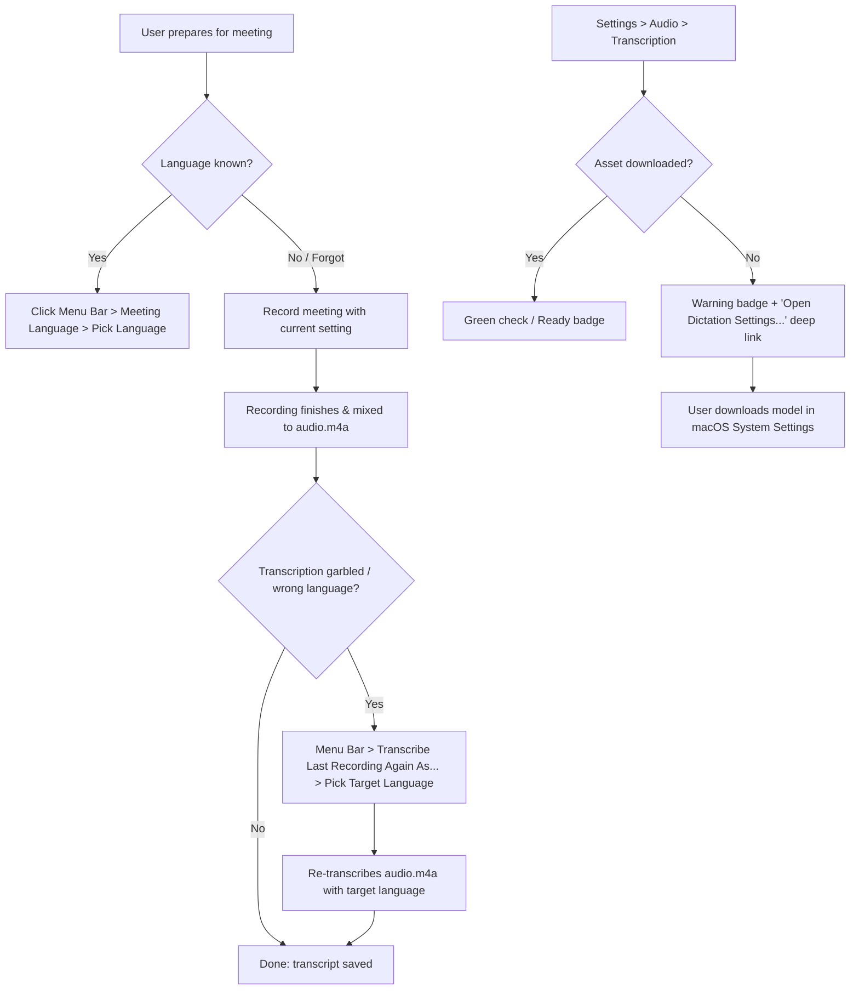

# Mission Specification: Multilingual Meeting Transcription (Quick Switcher & Offline Model Setup)

**Mission Branch**: `feat/issue-148-multilingual-transcription`  
**Created**: 2026-11-12  
**Status**: Ready for Planning  
**Input**: GitHub issue #148: "[Feature]: Multilingual Meeting Transcription (Quick Switcher & Offline Model Setup)" (Closes #148, refs #148)

---

## 1. Purpose

Many users work in bilingual or multilingual environments (e.g., English macOS system language, but frequent Dutch, German, French, or Spanish meetings). Currently:
1. Apple's on-device `SFSpeechRecognizer` requires offline language assets installed locally and cannot automatically detect language switching mid-stream.
2. If a user records a meeting in another language while Bitz is set to "Automatic" on an English Mac, the transcription produces garbled output because the recognizer defaults to English.
3. If the user selects a language whose on-device asset is not yet downloaded on macOS (e.g. `No Assistant asset for language nl-NL`), transcription fails or is unavailable with no guidance on how to install it.
4. Having to open the full Settings window to switch language before each meeting creates unnecessary friction.

This mission delivers a high-impact, low-overhead solution across three areas:
1. **Menu Bar Quick Language Switcher**: A lightweight `Meeting Language ▸` submenu directly in the Menu Bar extra so bilingual users can flip languages with a single click before recording.
2. **Settings Model Status & 1-Click Dictation Deep Link**: In `Settings > Audio > Transcription`, show whether the on-device asset for a language is downloaded or missing, and provide a 1-click button to open macOS Keyboard/Dictation Settings directly.
3. **"Transcribe Last Recording Again As..."**: Allow choosing the target language when re-transcribing the previous meeting audio (`audio.m4a`), saving users who forgot to change the language before the meeting started.

---

## 2. User Scenarios & Testing *(mandatory)*

### User Story 1 - Quick Language Switcher in Menu Bar (Priority: P1)

A bilingual developer whose Mac language is English is about to join a Dutch team sync. Without opening the full Settings window, they click the Bitz Menu Bar icon, hover over `Meeting Language ▸`, and select `Nederlands`. When they start recording, Bitz transcribes the Dutch conversation with accurate Dutch recognition.

**Why this priority**: Solves the primary daily friction point for bilingual users. A meeting starts in seconds; digging into Settings tabs causes users to miss the first minute or record in the wrong language.

**Independent Test**:
1. Open the Menu Bar extra.
2. Verify `Meeting Language ▸` submenu is present and lists Automatic plus supported/preferred languages with a checkmark on the active selection.
3. Click a different language; verify `MeetingSettingsStore.transcriptionLocaleIdentifier` is updated immediately.
4. Start a recording; verify the transcription uses the newly selected locale.

**Acceptance Scenarios**:
1. **Given** the Menu Bar extra is open, **When** the user inspects `Meeting Language ▸`, **Then** it displays `Automatic` and the available language options, with the currently active language marked as selected.
2. **Given** a language is selected via the Menu Bar submenu, **When** the user checks Settings > Audio, **Then** the Language picker reflects the same language selection without requiring a restart.
3. **Given** a meeting is currently recording, **When** the user opens the Menu Bar extra, **Then** the language switcher is disabled or informs the user that language applies to future recordings.

---

### User Story 2 - Re-Transcribing Previous Meeting in Another Language (Priority: P1)

A user forgot to switch the language to Dutch before a 30-minute meeting started, so Bitz transcribed it with the English model and produced unintelligible text. After the meeting ends, the user clicks Menu Bar → `Transcribe Last Recording Again As...` → `Nederlands`. Bitz re-runs the on-device transcription on `audio.m4a` using the Dutch speech recognizer, updates `transcript.txt` and `transcript.json`, and saves the meeting notes.

**Why this priority**: Safety net for the inevitable "I forgot to switch before the meeting" scenario. The high-quality audio is already captured; this rescues the transcript with zero re-recording.

**Independent Test**:
1. Record a mock audio file or provide a fixture session with `audio.m4a`.
2. Trigger `transcribeAgain(localeIdentifier: "nl-NL")`.
3. Verify that `MeetingRecorderService` re-transcribes using `nl-NL`, overwrites the previous transcript with the new Dutch text, and updates session metadata.

**Acceptance Scenarios**:
1. **Given** a completed recording with `canTranscribeAgain == true`, **When** the user views the Menu Bar, **Then** they see `Transcribe Last Recording Again` and a submenu `Transcribe Last Recording Again As...` listing languages.
2. **Given** the user selects a specific language from `Transcribe Last Recording Again As...`, **When** re-transcription runs, **Then** the target language is used for that session's transcript without crashing or altering existing unchanged settings if specified.
3. **Given** the speech bubble after a failed/garbled transcript, **When** the user clicks "Transcribe Again", **Then** the option or flow allows retrying with guidance.

---

### User Story 3 - Offline Model Download Status & System Settings Deep Link (Priority: P2)

A user selects a language in Settings > Audio whose on-device recognition asset has not yet been downloaded by macOS. Instead of failing silently or showing an obscure `No Assistant asset for language nl-NL` crash during transcription, Settings displays a clear status banner: "Offline model not downloaded. Required for on-device transcription." alongside a 1-click button: "Download in macOS Dictation Settings...". Clicking the button deep-links directly to macOS System Settings Keyboard/Dictation.

**Why this priority**: Eliminates user confusion when on-device recognition fails due to macOS asset provisioning. Provides an immediate, clear recovery path.

**Independent Test**:
1. Select a locale known to lack a downloaded on-device model.
2. Verify that `AudioSettingsTabView` displays a warning indicator and the deep-link button.
3. Click the button; verify `NSWorkspace.shared.open(...)` is invoked with the macOS System Settings Keyboard/Dictation URL.

**Acceptance Scenarios**:
1. **Given** the user selects a language in Settings > Audio whose on-device asset is missing, **When** the row is rendered, **Then** an informative warning is displayed explaining that the model needs to be downloaded in macOS.
2. **Given** the warning is shown, **When** the user clicks "Download in macOS Settings...", **Then** System Settings opens to the Keyboard / Dictation pane.
3. **Given** transcription fails during a meeting due to a missing asset error, **When** the failure speech bubble or status message appears, **Then** it clearly explains that the language model is not downloaded and suggests downloading it in macOS Dictation settings.

---

### Edge Cases

- **Missing On-Device Asset at Transcription Time**: If transcription starts and macOS returns an assistant/asset missing error, Bitz must catch it, produce a clear diagnostic error message (not raw kAFAssistantErrorDomain dump), and recommend downloading the model in System Settings.
- **System Settings Deep Link Compatibility**: macOS 14 (Sonoma), 15 (Sequoia), and newer use `x-apple.systempreferences:com.apple.Keyboard-Settings.extension?Dictation` or `x-apple.systempreferences:com.apple.preference.keyboard`. If opening fails, fallback gracefully to `x-apple.systempreferences:` or general keyboard pane.
- **Empty or Unsupported Locale List**: If Apple's `SFSpeechRecognizer.supportedLocales()` returns an empty list or encounters an unexpected locale string, graceful fallbacks (e.g. system locale / English) prevent crashes.
- **Mid-Recording Language Changes**: The Menu Bar switcher must not interrupt an active audio capture session. Changing language while recording should either be disabled or clearly marked as taking effect on the next recording.

---

## 3. Requirements *(mandatory)*

### Functional Requirements

| ID | Title | User Story | Priority | Status |
|----|-------|------------|----------|--------|
| FR-001 | Menu Bar Meeting Language Submenu | As a user, I want a `Meeting Language ▸` submenu in the Menu Bar extra so that I can switch meeting transcription language with a single click before recording. | High | Open |
| FR-002 | Active Language Checkmark in Menu Bar | As a user, I want the active transcription language (including Automatic) to be visually indicated in the Menu Bar submenu so that I know what language will be used. | High | Open |
| FR-003 | Transcribe Last Recording Again As... Submenu | As a user, I want a `Transcribe Last Recording Again As ▸` submenu in the Menu Bar extra allowing me to choose a target language so that I can fix transcripts recorded under the wrong language setting. | High | Open |
| FR-004 | Multi-Locale Transcribe Again API | As a developer, I want `MeetingRecorderService.transcribeAgain(localeIdentifier:)` to accept an explicit locale override so that re-transcription runs with the requested language. | High | Open |
| FR-005 | Model Asset Availability Detection | As a user, I want Bitz to detect when an on-device language asset is not installed or unavailable in macOS so that I am alerted before or immediately upon failure. | Medium | Open |
| FR-006 | System Settings Dictation Deep Link | As a user, I want a 1-click button in Settings > Audio to open macOS Keyboard/Dictation settings so that I can download missing language models with minimal effort. | Medium | Open |
| FR-007 | Friendly Asset Error Handling | As a user, I want errors caused by missing Assistant/Dictation assets to be formatted into actionable user-friendly messages rather than cryptic system codes. | High | Open |

### Non-Functional Requirements

| ID | Title | Requirement | Category | Priority | Status |
|----|-------|-------------|----------|----------|--------|
| NFR-001 | Zero Idle CPU Impact | Desktop idle CPU stays `< 2%` in release build with Settings closed; Menu Bar language items perform no background polling. | Performance | High | Open |
| NFR-002 | Memory Budget | App memory stays `< 70 MB` RSS; language lists are lazily initialized and cached without leak across switches. | Performance | High | Open |
| NFR-003 | Zero External Dependencies | Pure Swift / AppKit / SwiftUI / Speech.framework implementation with zero third-party dependencies. | Architecture | High | Open |
| NFR-004 | Deterministic Unit Tests | All stores, language ordering logic, and re-transcription locale routing have isolated unit tests with zero failures. | Reliability | High | Open |

### Constraints

| ID | Title | Constraint | Category | Priority | Status |
|----|-------|------------|----------|----------|--------|
| C-001 | Privacy & On-Device Only | Bitz never sends audio or speech off the Mac; transcription remains 100% on-device (`requiresOnDeviceRecognition = true`). | Privacy | High | Open |
| C-002 | Performance Invariants | Strictly adhere to `AGENTS.md` §2 performance invariants: no continuous SwiftUI animation, sizingOptions rules, and isolated subviews. | Architecture | High | Open |
| C-003 | Backward Compatibility | Persisted `bitz.meeting.transcriptionLocale` key remains intact and compatible with existing user defaults. | Compatibility | High | Open |

### Key Entities

- **Transcription Locale**: The BCP-47 identifier (e.g. `nl-NL`, `en-US`) or `nil` (Automatic) governing speech recognition.
- **Meeting Settings Store** (`MeetingSettingsStore`): Central store holding `transcriptionLocaleIdentifier`.
- **Meeting Recorder Service** (`MeetingRecorderService`): Coordinates recording, mixing, and transcription with optional locale override.
- **Speech Framework Transcription Service** (`SpeechFrameworkTranscriptionService`): Interfaces with Apple's `SFSpeechRecognizer` for on-device recognition and locale resolution.

---

## 4. Assumptions

- `SFSpeechRecognizer` remains the underlying engine for Apple on-device recognition.
- The macOS Dictation settings pane can be opened via standard Apple URL schemes (`x-apple.systempreferences:com.apple.Keyboard-Settings.extension?Dictation` or `x-apple.systempreferences:com.apple.preference.keyboard`).
- Users will primarily switch between Automatic, their system language, and 1–3 preferred languages; the menu bar will prioritize Automatic + preferred languages followed by other available options.

---

## 5. Success Criteria *(mandatory)*

### Measurable Outcomes

- **SC-001**: Bilingual users can switch meeting transcription language from the Menu Bar extra in under 2 clicks.
- **SC-002**: Re-transcribing a meeting with a different language produces a refreshed transcript in the selected language without re-recording audio.
- **SC-003**: In Settings > Audio, selecting a language missing an offline asset displays clear guidance and a working 1-click button to open macOS Dictation settings.
- **SC-004**: Idle CPU remains `< 2%` and memory remains `< 70 MB` in release build.
- **SC-005**: All test suites pass with zero regressions.
